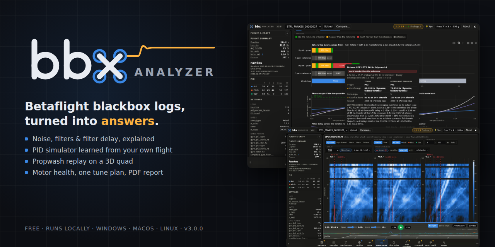
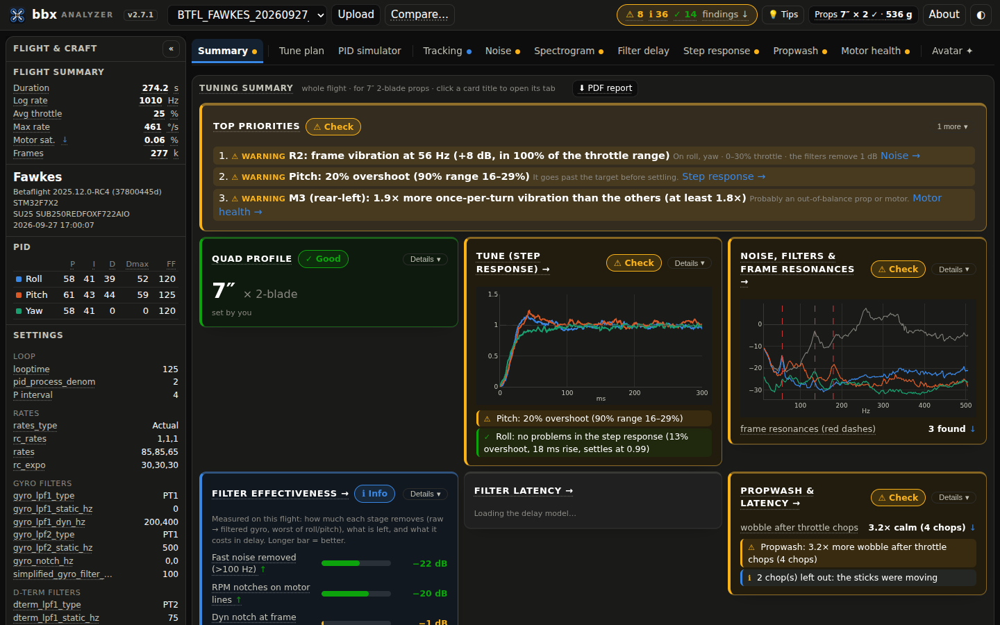
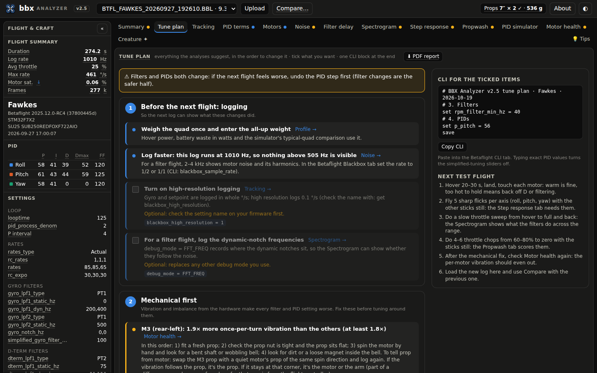
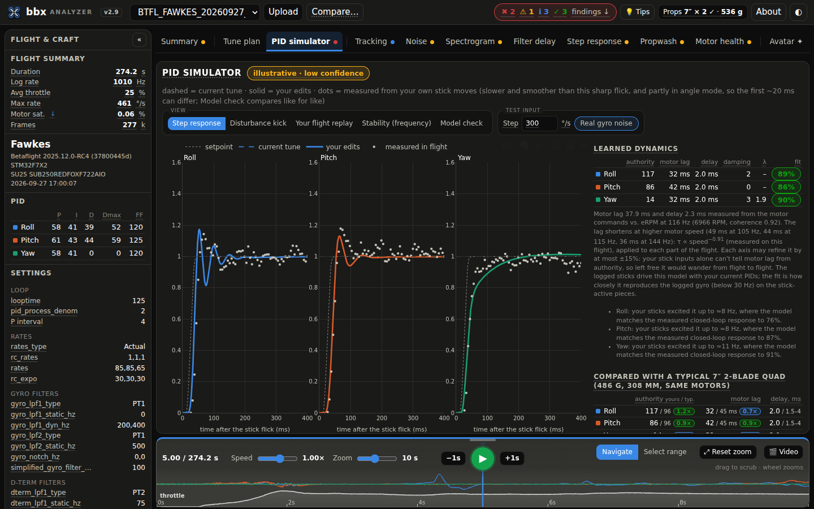
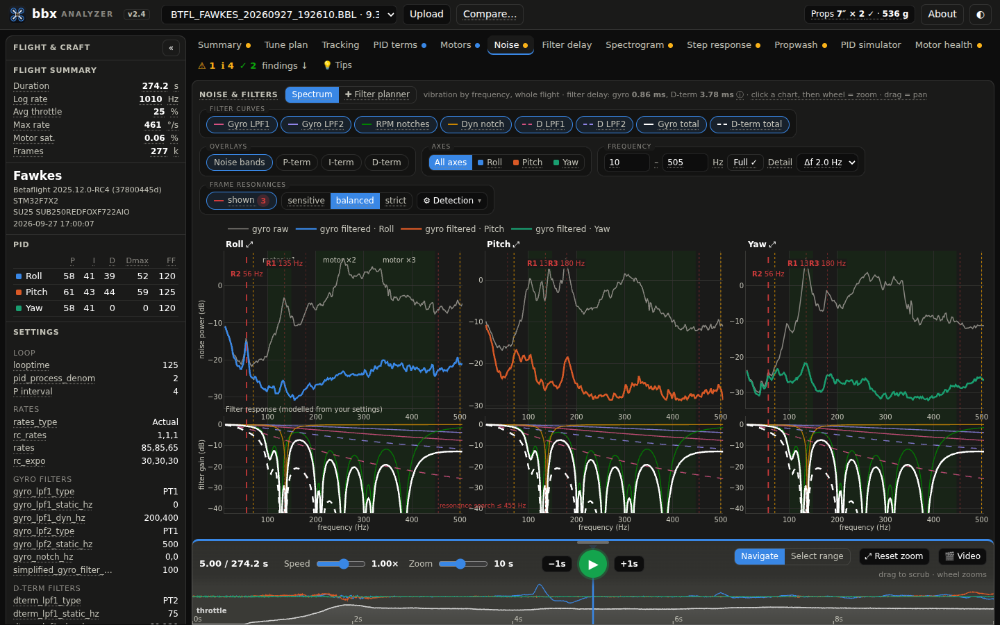
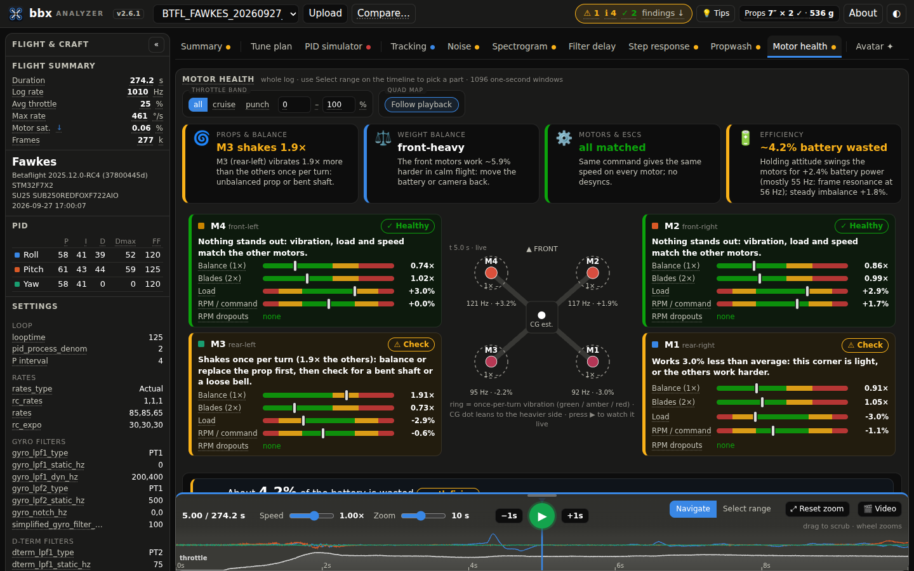
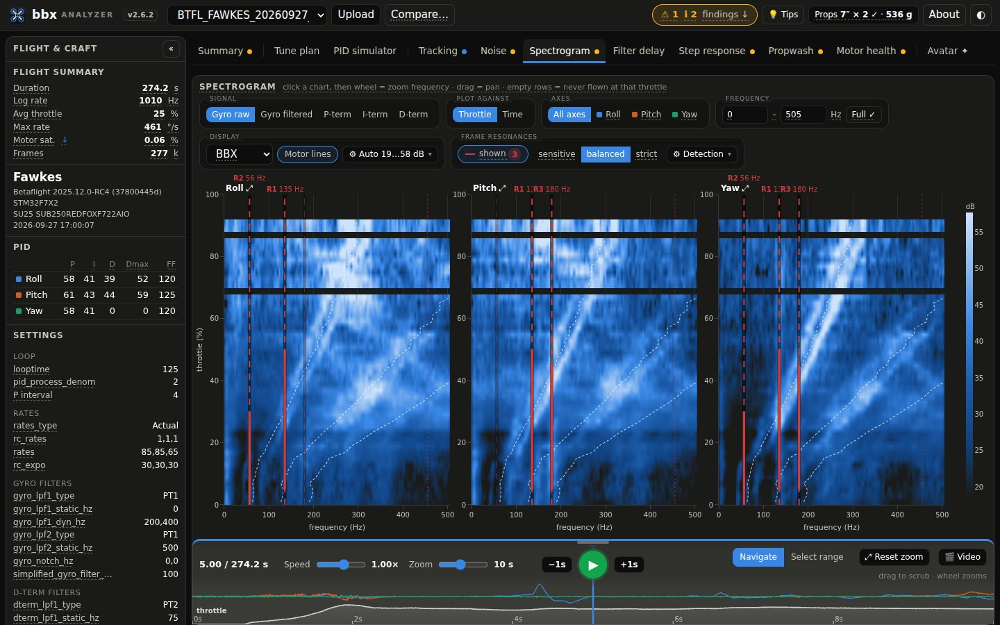
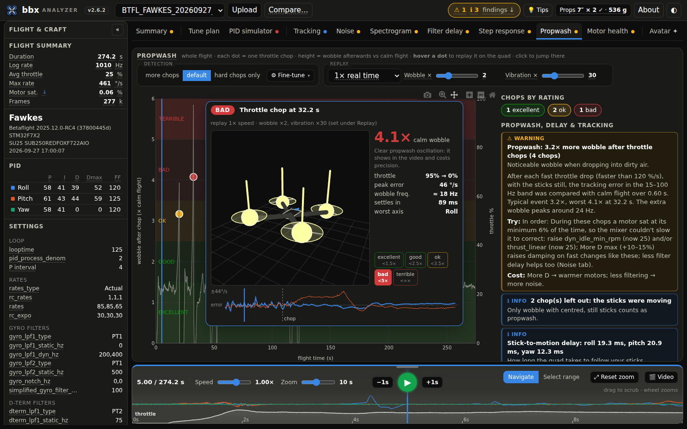
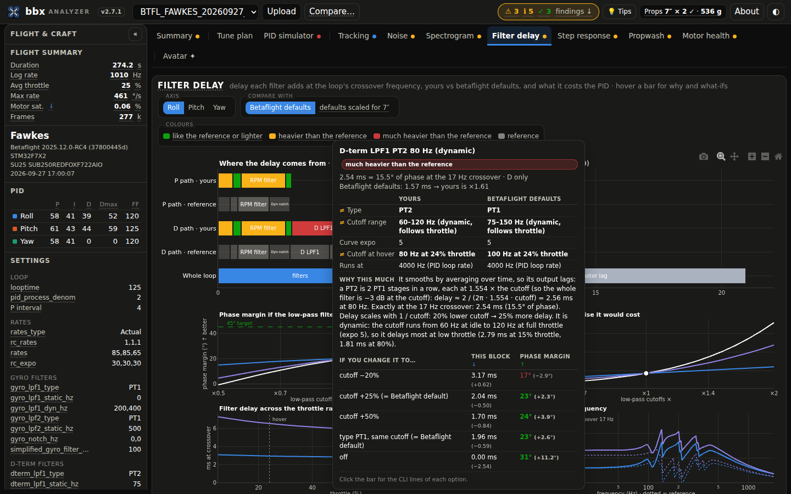
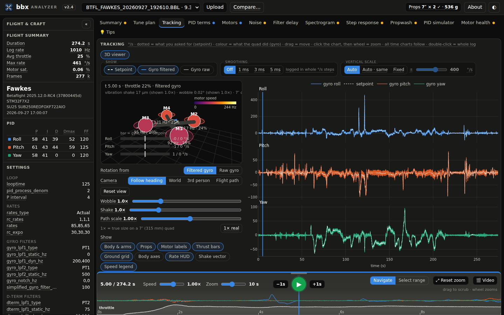

**BBX Analyzer** reads your Betaflight blackbox logs and tells you, in plain words, what is going on with your quad and what to try next. It covers noise and filters, frame resonances, the tune, propwash, and motor and prop health. Every finding comes from your own log, and each fix comes with the CLI lines.

It runs on your computer, in your browser. Your logs never leave your machine. **Current version: 2.6.2** ([what's new](CHANGELOG.md)).

---

## Get started (about 2 minutes)

1. **Download** the zip from [Releases](../../releases), or use **Code → Download ZIP** on this page.
2. **Unzip** it somewhere normal, such as Documents. Don't run it from inside the zip.
3. **Start it** for your system:

| | Do this | The first time only |
|---|---|---|
| **Windows** | Double-click **`start.bat`** | If a blue *"Windows protected your PC"* box appears, click **More info → Run anyway** (or **Run** if it asks *"Do you want to run this file?"*). |
| **macOS** | Double-click **`start.command`** | If macOS says it *"cannot be opened"*, right-click it → **Open** → **Open**. On newer macOS: **System Settings → Privacy & Security → Open Anyway**. |
| **Linux** | Run **`bash start.sh`** in a terminal from the folder | Afterwards it's in your applications menu as *BBX Analyzer*. |

Your browser opens BBX Analyzer by itself. **Drop a `.BBL` file** onto the page, or pick one from the list.

**You don't need to install anything first.** The first start sets everything up inside the folder and takes 1–3 minutes. It needs internet once. It uses the Python you already have (3.10–3.13); if there is none, it downloads a private copy just for BBX. Later starts take a few seconds.

After the first start you also get a **BBX Analyzer** shortcut with its icon: on the Desktop (Windows), as an app in the folder (macOS) or in the applications menu (Linux). To stop BBX, close its terminal window.

---

## What it does

Open a log and BBX answers three questions: **what is wrong, why, and what do I change.** Every answer comes from your own flight, is written in plain language, and ends with the CLI lines to paste.

### Start with the Summary and the Tune plan

| | |
|---|---|
| **Summary** | Top priorities first, then one card per analysis with its chart and main findings. Every number shows ▲ or ▼ for which direction is better. |
| **Tune plan** | Every suggestion from every analysis, in the order to apply it: logging, mechanical, filters, PIDs, feedforward. Opens with a table *Setting · Now · Suggested · Why*. Untick what you disagree with; the CLI block, warnings and a next-flight checklist are one click away. |
| **PDF report** | One click, made in your browser: priorities, key numbers, a section per area, the plan and its CLI. See the [sample report](docs/sample-report.pdf). |

### Understand your tune

| | |
|---|---|
| **PID simulator** | BBX learns your quad's real dynamics from the log (control authority, damping, motor lag from the eRPM) and runs Betaflight's PID loop with your actual filters against them. Change P, I, D, D max or FF and see the step response, a sudden kick and the stability margins. **✨ Suggest** searches around the gains you flew with and only proposes changes that keep overshoot, noise and phase margin in bounds, so pressing it twice never drifts. |
| **Step response** | Rise time, overshoot and settling per axis, measured from your stick moves, with plain verdicts. |
| **Tracking** | *Sticks vs gyro*, *PIDs vs gyro* and *Motors vs RPM* in one tab, on a synced timeline with a 3D replay quad and your video if you load it. |
| **Propwash** | Every throttle chop is found, scored only while the sticks are still and rated *excellent* to *terrible*. Hover a chop to replay it on a 3D quad. |

### Understand your filters and noise

| | |
|---|---|
| **Noise** | Noise spectrum per axis, raw against filtered, with the filter curves, frame resonances (stay at one frequency while motor noise moves with RPM) and a **filter planner** that proposes notches and predicts the effect on noise and delay before you fly. |
| **Spectrogram** | Noise against time and throttle. With `debug_mode` FFT_FREQ, DYN_LPF or RPM_FILTER the logged notch and motor frequencies are drawn on top. |
| **Filter delay** | Each filter's delay at the loop's crossover frequency as stacked bars, next to Betaflight's defaults (checked against the source) or those scaled to your prop size. Hover for why, and the exact phase margin after each possible change. |

### Understand your hardware

| | |
|---|---|
| **Motor health** | One card per motor: once-per-turn vibration (*"M3 vibrates 1.9× more than the others: unbalanced prop or bent shaft"*), load balance, speed for the same command, desyncs. |
| **Battery** | Estimates the power lost to motors twitching, buzzing on noise and uneven load, shown on your own motor traces. No current sensor needed. |
| **Quad profile** | Prop size, blade count and weight are estimated from the log (you can set them) so advice fits a 2.5″ whoop and a 10″ rig alike. |

### Compare and share

- **Before → after.** Open two flights: BBX lists the settings you changed, what got better or worse, and what to try next.
- **Avatar.** For fun: your flight is scored on eight axes and matched to one of 150 creatures, from dragons to a flying pig, next to a copy of your quad flying the same flight.

| | |
|---|---|
|  |  |
|  |  |

---

## Good to know

- **Which logs?** Betaflight `.BBL` / `.BFL` files. For the motor analyses, turn on **bidirectional DShot** (eRPM in the log). Logging at 1–2 kHz is ideal.
- **Where are my logs kept?** In the `logs` folder inside BBX. Decoded logs and the learned quad models are cached there (`*.npz`, `*.sim.json`), so a log opens instantly the second time. Delete them any time; they're rebuilt when needed.
- **Speed.** The launchers also install `numba` when it's available for your Python: it compiles the simulator's inner loops, so learning a quad's dynamics takes a few seconds instead of ~15. Without it everything works, just slower.
- **Does it need the internet?** Only for the first setup. After that it works offline.
- **Suggestions are a starting point.** BBX explains *why* it suggests something, but every quad is different. Change one thing at a time, hover-test first and check motor temperature.

<b>Troubleshooting</b>

- **Windows: nothing happens / a window flashes and closes.** Unzip first (right-click the zip → *Extract All…*), then run `start.bat` from the extracted folder.
- **"Could not set up Python automatically".** Install Python 3.12 from [python.org](https://www.python.org/downloads/) (on Windows tick *"Add python.exe to PATH"*), then start again.
- **macOS: "cannot be opened because it is from an unidentified developer".** See the macOS row above. You can also open *Terminal*, type `bash ` (with a space), drag `start.command` into the window and press Enter.
- **The browser didn't open.** Copy the address shown in the terminal window (for example `http://127.0.0.1:8000`) into your browser.
- **Start over clean.** Delete the hidden `.venv` and `.tools` folders inside BBX and start again.
- **Still stuck?** Open an issue and paste what the terminal window shows.

<b>For developers</b>

Python (FastAPI + numpy, numba optional) backend and a vanilla JS + Plotly frontend, no build step. Run it by hand with
`pip install -r requirements.txt` + the orangebox wheel (see `start.sh`), then `uvicorn app:app`.
How the analyses work, and the reasoning behind them, is in **[docs/TECHNICAL.md](docs/TECHNICAL.md)**.

Logs are decoded by `fastbbl.py`, a specialised decoder that gives exactly the same output as orangebox (checked by the tests) about 4× faster; orangebox stays as the fallback. Run the tests with
`pip install -r requirements-dev.txt` and `python -m pytest tests` (decoder parity on a short real log and every log in `logs/`, truncated and corrupted logs, units, debug-mode tables, filter maths against closed forms and the Betaflight defaults, the compiled simulator against the numpy one, all analyses, the tune plan, the comparison and the web API).

**Releasing.** Docs are part of every release: `python tools/release.py all` regenerates the screenshots, the banner and the sample PDF report from the app (demo log), checks that README, CHANGELOG, the launchers and `version.py` agree and that the docs were made from the current code, runs the tests and builds `dist/bbx-analyzer-v<version>.zip`. Add a CHANGELOG entry and bump `version.py` first.

---

## Licence & credits

BBX Analyzer © 2026 **Martin Dimitrievski**. Free to use, modify and share for **non-commercial** purposes (see [LICENSE](LICENSE)). Commercial use needs written permission.

Built on [orangebox](https://github.com/atomgomba/orangebox) (blackbox decoding), [Plotly.js](https://plotly.com/javascript/), [FastAPI](https://fastapi.tiangolo.com/) and [NumPy](https://numpy.org/).
Thanks to the Betaflight developers and the FPV community, who document filters, PIDs and blackbox fields so the rest of us can understand our quads.
